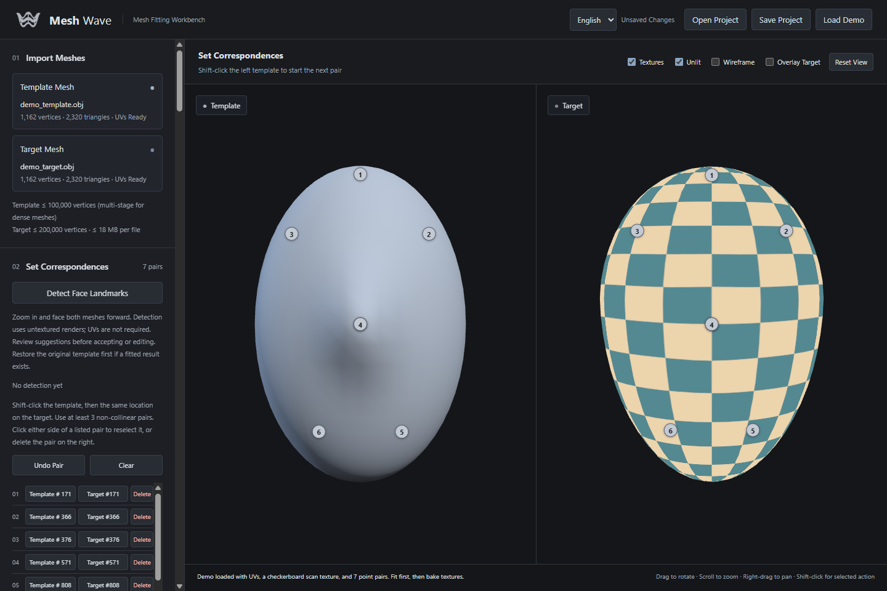
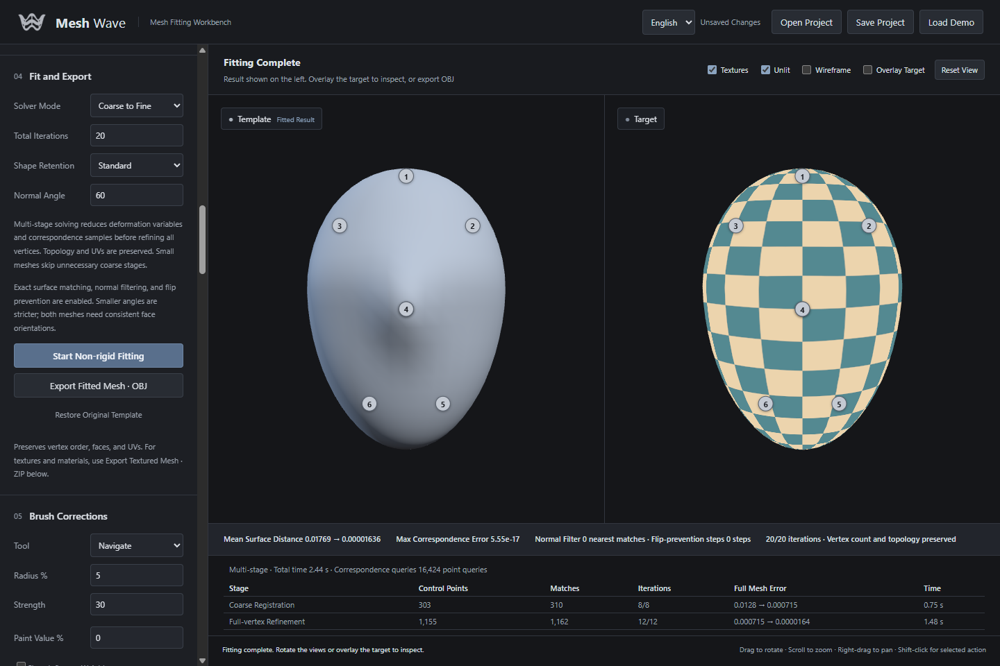
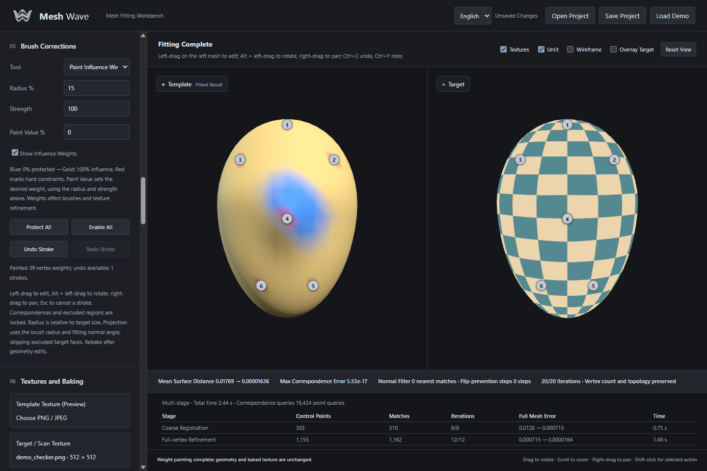
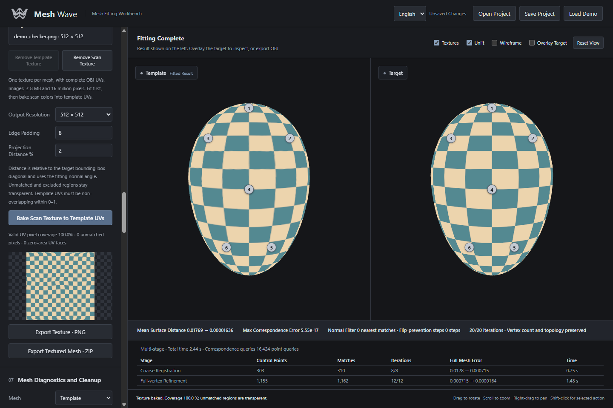

# Mesh Wave

[简体中文](README.md) | [English](README.en.md)

A local 3D mesh fitting tool that wraps a template onto a scan while preserving the template's topology and UVs. Includes texture baking, brush corrections, and batch processing for expression sequences.

**Workflow:** Import OBJ files → Set correspondences → Fit the template → Inspect and refine → Export meshes and textures.

## Main features

| Feature | Description |
| --- | --- |
| Mesh fitting | Single-stage or coarse-to-fine solving, exact triangle-surface distances, normal filtering, and local triangle flip prevention |
| Fit quality inspection | Error heatmap, adjustable threshold, global/local mean, RMS, P95, maximum error, and normal issue counts |
| Points and curves | Continuous surface or vertex pairs with editing; frontal face landmark suggestions; arc-length sampling of cubic surface splines |
| Region protection | Fixed template regions, excluded target regions, soft masks, and vertex influence painting |
| Brush corrections | Push, pull, smooth, project onto the scan, and smooth along its surface, with brush undo and redo |
| Textures | Preview textures, bake scan colors into template UVs, and export PNGs or textured mesh ZIPs |
| Texture-assisted fitting | Use optical flow to refine correspondences between expressions of the same person |
| Mesh diagnostics | Highlight non-manifold edges, invalid faces, isolated vertices, and winding issues; preview and export cleaned meshes |
| Batches and sequences | Automated fitting, optical flow refinement, baking, and export; forward, bidirectional, and adaptive temporal smoothing; anomaly detection and interpolation-based frame repair |
| Project files | Save meshes, textures, constraints, settings, and the current result, then reopen them to continue editing |
| Interface language | Switch instantly between Chinese and English; your choice is remembered in the current browser |

For detailed controls and limitations, see the [user guide (Chinese)](docs/user-guide.md).

## Screenshots

These screenshots show the English version of the running Graphite Studio interface using the built-in synthetic demo meshes and checkerboard texture. They illustrate the workflow, not fitting accuracy on real face scans. The app supports both Chinese and English; use the language selector in the top-right corner to switch.

### Point correspondences

Inspect the template and target side by side and establish correspondences with numbered point pairs.



### Coarse-to-fine fitting

Review stage statistics, surface distances, and export controls after fitting.



### Weight painting

Paint gradual influence weights on the mesh. Blue indicates low-weight protection, while red highlights hard constraints. Brush strokes support undo and redo.



### Texture baking and export

Transfer scan colors to the template UVs, inspect the baked image and coverage, and export a PNG or textured mesh ZIP.



## Requirements

- **Python:** 64-bit Python 3.11 is recommended. The validated environment uses Python 3.11.9; other versions and operating systems have not been fully tested.
- **Browser:** A desktop browser with WebGL support, such as Chrome or Edge.
- **Python packages:** NumPy, SciPy, Pillow, MediaPipe, and OpenCV, installed through `requirements.txt`.
- **Node.js / npm:** Not required for normal use. Frontend runtime files are included in the repository. Node.js is only needed to regenerate those files or run JavaScript tests.

Geometry processing and face detection run locally on the CPU; CUDA is not required. Installing dependencies requires an internet connection. Once dependencies and model assets are installed, the app runs without a CDN, cloud API, or API key.

## Download and install (Windows)

### 1. Get the code

On GitHub, choose **Code → Download ZIP**, extract the archive into a writable folder, and open PowerShell in that folder. Extract the files before launching the app.

Alternatively, use Git:

```powershell
git clone https://github.com/zxgtor/MeshWave.git
cd MeshWave
```

Run all subsequent commands from the project root containing `server.py` and `requirements.txt`.

### 2. Install Python dependencies

Install Python 3.11 and confirm the version with `python --version`, then run:

```powershell
python -m venv .venv
.\.venv\Scripts\python.exe -m pip install --upgrade pip
.\.venv\Scripts\python.exe -m pip install -r requirements.txt
```

These commands use the virtual environment's Python directly, so no activation script is needed. If you have multiple Python installations, you can replace the first command with `py -3.11 -m venv .venv`.

Verify the dependencies:

```powershell
.\.venv\Scripts\python.exe -c "import numpy, scipy, PIL, mediapipe, cv2; print('Dependencies OK')"
```

The repository includes `models/face_landmarker.task`. Only if this file is missing or fails verification, download the official model again with the following command, which requires an internet connection:

```powershell
.\.venv\Scripts\python.exe setup_landmarks.py
```

See the [model notes](models/README.md) for its source and checksum.

## Start and stop

### Windows launcher

After installing dependencies, double-click **`start.cmd`**. The launcher prefers the project's `.venv`, checks dependencies, starts the service in the background, and opens:

**<http://127.0.0.1:6188/>**

If Mesh Wave is already running on that port, the launcher opens the existing service. If startup fails, check `server-error.log` and `server.log` in the project folder.

### Command-line launch

To see logs directly and stop the service easily, run this in PowerShell:

```powershell
.\.venv\Scripts\python.exe server.py
```

Open the address above manually. Keep the terminal running and press **Ctrl+C** to stop the service. Closing the browser does not stop Python. For a background service started by `start.cmd`, use Task Manager to identify and end this project's `server.py` process by its command line.

If another application uses port 6188, choose a different port:

```powershell
.\.venv\Scripts\python.exe server.py --port 6189
```

Then open <http://127.0.0.1:6189/>. The `start.cmd` launcher continues to use the default port, 6188.

### Manual launch on macOS / Linux

The launcher scripts are Windows-only. You can try the following on other systems, but those platforms have not been fully tested, and installation depends on Python package availability for your platform:

```bash
python3 -m venv .venv
.venv/bin/python -m pip install --upgrade pip
.venv/bin/python -m pip install -r requirements.txt
.venv/bin/python server.py
```

## First run

Use the **中文 / English** selector in the top-right corner to switch languages without reloading. Chinese is the default; your choice is saved in the current browser. Switching does not change meshes, correspondences, settings, results, or brush undo history. Filenames and custom curve names retain their original spelling.

1. Click **载入演示 (Load demo)** to try the app without your own files. The synthetic demo includes UVs, a checkerboard scan texture, and seven preset point pairs. Use it to try fitting, baking, and export; it is not a face detection test.
2. For your own data, import a **template OBJ** and a **target scan OBJ**. The fitted result retains the template's vertex order, original faces, and UVs.
3. Hold **Shift**, click a point on the template, then click the corresponding location on the target. Set at least three non-collinear pairs, preferably spread across the fitting region. For frontal faces, you can generate automatic suggestions and review them before accepting.
4. Keep the default **多阶段 · 从粗到细 (Multi-stage, coarse to fine)** mode and click **开始非刚性贴合 (Start non-rigid fitting)**. Rotate the views or overlay the target to inspect the result; use brushes for corrections if needed.
5. Export an OBJ directly. For textures, load the scan image, bake it into the template UVs, then export a PNG or textured mesh ZIP.
6. Click **保存工程 (Save project)** to download a `.facewrap.json` file. Use **打开工程 (Open project)** to resume later. Projects are not saved automatically.

The default **Surface Point** placement stores continuous positions inside triangles and enforces barycentric equalities in single-stage and multi-stage fitting. **Snap to Vertex** remains available. New curves use interpolating cubic splines projected onto the mesh, then sampled by arc length; match the starting points and direction on both sides. Legacy vertex pairs and mesh polylines remain compatible. Projects containing new constraints use version 2. Brushes, optical flow, and temporal processing conservatively lock the supporting vertices of surface points to preserve their constraints.

In normal navigation, drag with the left mouse button to rotate, use the wheel to zoom, and drag with the right button to pan. In brush mode, use **Alt + left drag** to rotate. See the [user guide (Chinese)](docs/user-guide.md) for additional shortcuts and constraint rules.

After fitting, click **Compute / Refresh Errors** in section 04 to show the heatmap. Enable **Local Inspection** and Shift-click an eye, lip, or another region on the left mesh, or choose **Locate Maximum Error**. Blue → yellow → red indicates increasing distance; red reaches the selected threshold. Optionally highlight normal issues in purple. Distances use OBJ units; thresholds and radii are percentages of target size. Inspection preserves project data and undo history. Recompute after geometry edits. Small surface distances do not prove anatomical correspondence; self-intersections are not checked.

## Inputs and outputs

| Type | Supported scope |
| --- | --- |
| Geometry input | OBJ, up to 18 MB per file; templates up to 100,000 vertices, with multi-stage mode required above 25,000; targets up to 200,000 vertices and 500,000 triangles |
| Texture input | One PNG/JPEG color image per mesh, up to 8 MB and 16 million pixels; external MTL files with multiple textures are not parsed automatically |
| UV baking | Complete, non-overlapping template UVs in a single 0–1 tile, plus complete scan UVs; output resolutions of 256 / 512 / 1024 / 2048; no UDIM support |
| Geometry output | OBJ preserving template vertex order, original faces, and UVs; old normal references are removed, so recalculate normals in your destination application |
| Texture output | RGBA PNG, or a ZIP containing OBJ, MTL, color, and opacity images; keep their relative paths after extraction |
| Projects and batches | `.facewrap.json` projects; batch ZIPs with results and JSON/CSV reports; up to 50 items per batch |

Batch inputs, results, and reports are stored in `output/batches/`. They are not embedded in project files and are not cleaned up automatically. Keep the Python service running during batch processing. After an interruption, completed results remain available, but solving does not resume automatically.

## Troubleshooting

| Problem | What to check |
| --- | --- |
| `python` is not found or opens Microsoft Store | Check the Python installation and PATH, or try `py -3.11` when creating the environment |
| Missing module | Run `.\.venv\Scripts\python.exe -m pip install -r requirements.txt`; use the same environment for installation and startup |
| MediaPipe installation fails | Confirm you are using 64-bit Python 3.11, upgrade pip in that environment, and retain the full error output for diagnosis |
| The page does not open | Check that the service is running and the address and port are correct; launch from a terminal to see errors or inspect the logs |
| Blank viewport or missing mesh | Check browser WebGL support and hardware acceleration, confirm a mesh is loaded, and click 视图复位 (Reset view) |
| Face detection fails | Check the model file, turn both faces forward, and zoom in. Occlusion, untextured meshes, and extreme expressions can cause failure; manual point selection remains available |
| Transparent areas in the baked texture | Check UVs, fitting error, exclusions, projection distance, and normal angle; regions without a reliable match remain transparent |

## Scope and limitations

Mesh Wave is an independently implemented local prototype for templates and scans with similar shapes. It does not currently include a node editor, FBX/Alembic support, automatic UV unwrapping, or a complete animation pipeline. Local triangle flip prevention is not global self-intersection detection. Review automatic landmarks, optical flow refinements, and repaired frames manually. Input limits do not mean every maximum-size combination has been performance-tested.

The service listens only on local `127.0.0.1`; input data and computation stay on your machine. See the [user guide (Chinese)](docs/user-guide.md) for detailed algorithm boundaries, the [validation log (Chinese)](docs/validation.md) for recorded checks, and the [REA notes (Chinese)](docs/rea-notes.md) for implementation research.

## Development and tests

This section is optional for normal use. The frontend uses vanilla JavaScript and Three.js, with no additional bundling step. To regenerate the frontend runtime files included in the repository, install Node.js / npm and run:

```powershell
npm ci
npm run vendor
```

Run the existing tests:

```powershell
.\.venv\Scripts\python.exe -m unittest discover -s tests -v
node --test tests/brush.test.mjs tests/i18n.test.mjs tests/fit-quality.test.mjs tests/surface-points.test.mjs
```

The Three.js MIT license is included in [THREE-LICENSE.txt](web/vendor/THREE-LICENSE.txt). See the [model notes](models/README.md) for the face landmark model source.
