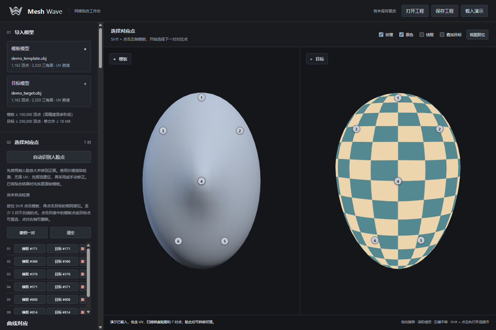
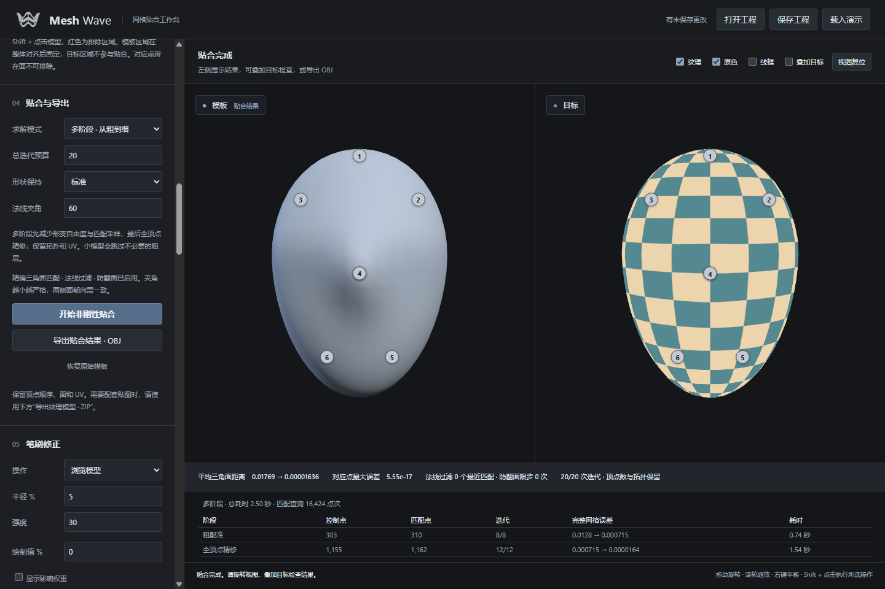
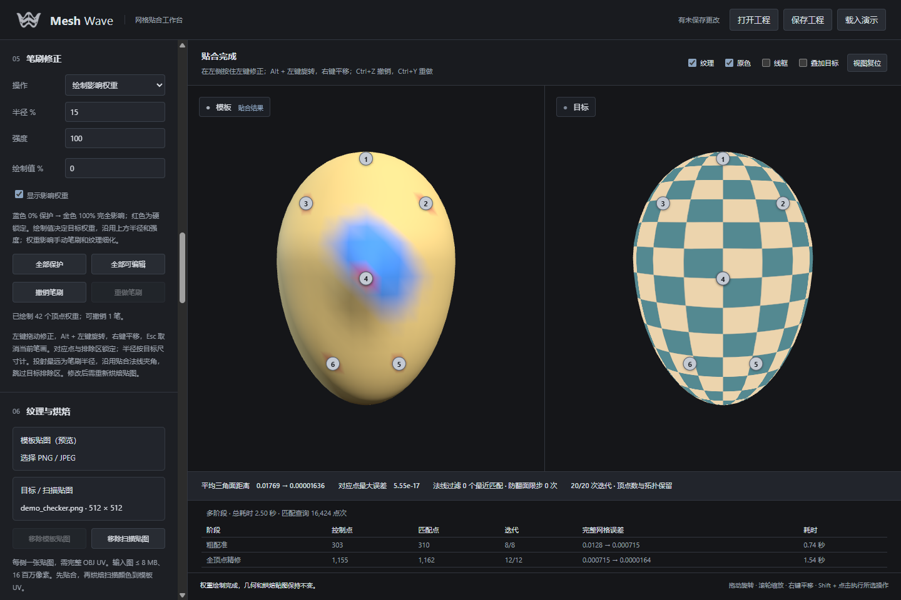
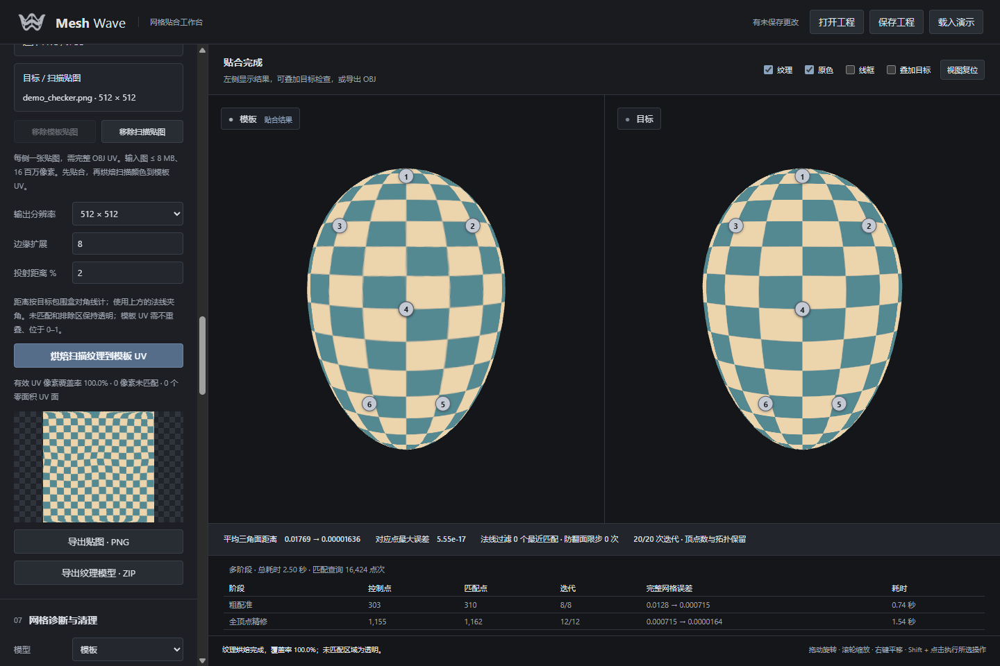

# Mesh Wave

[简体中文](README.md) | [English](README.en.md)

本地运行的三维网格贴合工具，将模板贴合到扫描模型，保留模板拓扑与 UV，支持纹理烘焙、笔刷修正和表情序列批处理。

**基本流程：** 导入 OBJ → 建立对应点 → 非刚性贴合 → 检查与修正 → 导出模型及贴图。

## 主要功能

新增 [API、MCP 与网页任务同步](docs/automation.md)：无浏览器调用、共享拟合进度、阶段网格预览与运行中取消，支持中英文。

| 功能 | 说明 |
| --- | --- |
| API 与 MCP | Headless HTTP 服务、MCP 工具、共享拟合任务进度与阶段预览、运行中取消 |
| 网格贴合 | 单阶段或从粗到细多阶段求解，精确三角面距离、法线过滤与局部防翻面保护 |
| 贴合质量检查 | 误差热图、可调阈值、全局／局部平均值、RMS、P95、最大误差和法线异常统计 |
| 对应点与曲线 | 连续表面点与顶点点对、重选和删除；正面人脸点辅助检测；三次表面样条按弧长生成对应点 |
| 区域保护 | 模板固定/随动区域、目标排除区域、参与几何求解的软遮罩与顶点权重绘制 |
| 笔刷修正 | 外推、内压、平滑、表面投射和贴面平滑，支持笔刷撤销与重做 |
| 纹理处理 | 纹理预览，将扫描颜色烘焙到模板 UV，导出 PNG 或带材质的模型 ZIP |
| 纹理辅助贴合 | 利用光流细化同一人物不同表情之间的对应关系 |
| 网格诊断 | 检测和高亮非流形边、无效面、孤立点及绕序问题，提供清理预览与导出 |
| 批处理与时序 | 自动贴合、光流细化、烘焙和导出；单向、双向及自适应时序平滑，异常帧检测与插值修复 |
| 工程保存 | 保存模型、纹理、约束、参数与当前结果，重新打开后继续编辑 |
| 界面语言 | 中文 / English 即时切换，并记住当前浏览器的语言选择 |

模板排除区可选择整体对齐后固定，或不参与贴面但随周围形变。先贴合并绘制软权重，再重新求解：0% 保持整体对齐位置，正权重调节表面吸附，硬对应点优先。区域模式和权重会随工程及批次快照保存。

局部防翻面会保留风险区域当前的安全控制量，再求解其他区域，避免少数薄层让整张网格提前停止；仍保留对应点、固定区和完整路径的 1% 投影面积保护。

完整操作及各项限制见 [使用指南](docs/user-guide.md)。

## 界面预览

以下截图来自实际运行的 Graphite Studio 界面，使用“载入演示”提供的合成模型与棋盘纹理。演示用于展示操作流程，不代表真实人脸扫描的贴合精度。

### 对应点编辑

左右并排检查模板与目标，通过编号点对建立对应关系。



### 多阶段贴合

查看从粗配准到全顶点精修的阶段统计、表面距离和结果导出入口。



### 权重笔刷

在模型上绘制渐变影响权重，蓝色区域表示低权重保护，红色标记硬锁定；支持笔刷撤销与重做。



### 纹理烘焙与导出

将扫描颜色转移到模板 UV，预览烘焙贴图与覆盖率，导出 PNG 或带贴图模型 ZIP。



## 环境要求

- **Python：** 建议使用 64 位 Python 3.11，当前验证环境为 3.11.9。其他版本及操作系统未做完整验证。
- **浏览器：** 支持 WebGL 的桌面浏览器，例如 Chrome 或 Edge。
- **Python 依赖：** NumPy、SciPy、Pillow、MediaPipe、OpenCV，由 `requirements.txt` 安装。
- **Node.js / npm：** 普通使用不需要。仓库已包含前端运行资源；仅重新生成前端依赖或运行 JavaScript 测试时需要。

几何计算和人脸检测在本机 CPU 上运行，不需要 CUDA。首次安装依赖需要网络；依赖安装完成、模型资源齐全后，运行不依赖 CDN 或云端 API，不需要 API Key。

## 下载与安装（Windows）

### 1. 获取代码

在 GitHub 点击 **Code → Download ZIP**，解压到可写目录，再在该目录打开 PowerShell。请先解压，不能直接在 ZIP 内启动。

也可使用 Git：

```powershell
git clone https://github.com/zxgtor/MeshWave.git
cd MeshWave
```

后续命令均在包含 `server.py` 和 `requirements.txt` 的项目根目录执行。

### 2. 安装 Python 依赖

先安装 Python 3.11，确认 `python --version` 显示正确版本，然后执行：

```powershell
python -m venv .venv
.\.venv\Scripts\python.exe -m pip install --upgrade pip
.\.venv\Scripts\python.exe -m pip install -r requirements.txt
```

以上直接使用虚拟环境中的 Python，无需运行激活脚本。如果有多个 Python，也可将第一条命令换成 `py -3.11 -m venv .venv`。

验证依赖：

```powershell
.\.venv\Scripts\python.exe -c "import numpy, scipy, PIL, mediapipe, cv2; print('Dependencies OK')"
```

仓库已包含 `models/face_landmarker.task`。仅当文件缺失或校验失败时，执行以下命令重新下载官方模型；该步骤需要网络：

```powershell
.\.venv\Scripts\python.exe setup_landmarks.py
```

模型来源和校验值见 [模型说明](models/README.md)。

## 启动与停止

### Windows 一键启动

安装依赖后双击 **`start.cmd`**。脚本优先使用项目的 `.venv`，检查依赖并在后台启动服务，随后打开：

**<http://127.0.0.1:6188/>**

如果同一端口已运行 Mesh Wave，脚本直接打开现有服务。启动失败时查看项目目录中的 `server-error.log` 和 `server.log`。

### 命令行启动

希望直接查看日志、方便停止服务时，在 PowerShell 中执行：

```powershell
.\.venv\Scripts\python.exe server.py
```

然后手动打开上述网址。保持终端运行，按 **Ctrl+C** 停止服务。关闭网页不会停止 Python 服务；通过 `start.cmd` 后台启动的服务，可在任务管理器中根据命令行找到本项目的 `server.py` 进程并结束。

如果 6188 端口被其他程序占用，可改用：

```powershell
.\.venv\Scripts\python.exe server.py --port 6189
```

此时打开 <http://127.0.0.1:6189/>；`start.cmd` 仍使用默认的 6188 端口。

### macOS / Linux 手动启动

一键脚本仅支持 Windows。其他系统可尝试以下方式，相关平台未做完整验证，依赖能否安装取决于对应平台的 Python 软件包支持：

```bash
python3 -m venv .venv
.venv/bin/python -m pip install --upgrade pip
.venv/bin/python -m pip install -r requirements.txt
.venv/bin/python server.py
```

## 首次使用

右上角的语言选择框可在 **中文 / English** 之间切换，无需刷新。默认中文，选择保存在当前浏览器；切换不会修改模型、点对、参数、当前结果或笔刷撤销记录。文件名和自定义曲线名保留原文。

1. 点击 **载入演示**，无需自己的模型即可试用。演示是带 UV 和棋盘纹理的合成模型，已设置 7 对对应点，适合体验贴合、烘焙和导出；它不适合测试自动人脸检测。
2. 使用自己的数据时，分别导入**模板 OBJ** 和**目标扫描 OBJ**。模板的顶点顺序、原始面和 UV 将保留到贴合结果。
3. 按住 **Shift**，先点模板，再点目标的相同部位。至少建立 3 对不共线的对应点，建议覆盖整个待贴合区域。正面人脸可先生成自动建议，检查后再采用。
4. 使用默认的**多阶段 · 从粗到细**模式，点击**开始非刚性贴合**。旋转视图或叠加目标检查结果，必要时用笔刷修正。
5. 直接导出 OBJ；如需纹理，先加载扫描贴图，再烘焙到模板 UV，导出 PNG 或纹理模型 ZIP。
6. 点击顶部**保存工程**下载 `.facewrap.json`，再次使用时通过**打开工程**恢复。工程不会自动保存。

默认选点方式为**连续表面点**：位置保存在三角面内部，并以重心坐标参与单阶段／多阶段求解；也可切回顶点吸附。新建曲线使用三次插值样条，经表面投射后按弧长采样；两侧起点与方向需一致。旧工程的顶点点对和网格折线保持兼容。包含新约束的工程保存为版本 2；笔刷、光流及时序阶段会保守锁定表面点涉及的顶点，以保持约束。

普通视图：左键拖动旋转，滚轮缩放，右键平移。笔刷模式中用 **Alt + 左键**旋转；详细快捷键与约束规则见 [使用指南](docs/user-guide.md)。

贴合后，在第 04 节点击**计算／刷新误差**显示热图。开启**局部检查**，Shift 点击左侧眼周、嘴唇等位置，或点击**定位最大误差**查看邻域统计。蓝→黄→红表示距离增大，红色达到所设阈值；可单独以紫色标出法线异常。距离使用 OBJ 原单位，阈值和半径按目标尺寸百分比设置。检查不修改工程或撤销历史，几何变化后需重新计算；表面距离小不代表解剖对应正确，也不检查自相交。

## 输入与输出

| 类型 | 支持范围 |
| --- | --- |
| 几何输入 | OBJ；单文件 ≤ 18 MB；模板 ≤ 100,000 顶点，超过 25,000 顶点需多阶段模式；目标 ≤ 200,000 顶点、500,000 三角面 |
| 纹理输入 | 每个模型一张 PNG/JPEG 颜色图，≤ 8 MB、16 百万像素；不自动解析外部 MTL 多材质贴图 |
| UV 烘焙 | 模板使用完整、无重叠的单张 0–1 UV，扫描也需完整 UV；输出分辨率 256 / 512 / 1024 / 2048，不支持 UDIM |
| 几何输出 | 保留模板顶点顺序、原始面与 UV 的 OBJ；移除旧法线引用，使用时需重算法线 |
| 纹理输出 | RGBA PNG；模型 ZIP 包含 OBJ、MTL、颜色与透明度贴图，解压后保持相对路径 |
| 工程与批次 | `.facewrap.json` 工程；批次 ZIP 含结果及 JSON/CSV 报告，每批最多 50 项 |

批次输入、结果与报告保存在 `output/batches/`，不包含在工程文件中，也不会自动清理。批处理期间请保持 Python 服务运行；服务中断后可查询已完成结果，但不会自动继续求解。

## 常见问题

| 问题 | 处理方法 |
| --- | --- |
| 找不到 `python` 或打开了 Microsoft Store | 检查 Python 安装与 PATH；也可尝试 `py -3.11` 创建虚拟环境 |
| 提示缺少模块 | 使用 `.\.venv\Scripts\python.exe -m pip install -r requirements.txt`，确保安装与启动使用同一环境 |
| MediaPipe 安装失败 | 核对是否为 64 位 Python 3.11，再升级该虚拟环境中的 pip；保留完整错误信息排查 |
| 网页无法打开 | 确认服务仍在运行、网址和端口正确；命令行启动查看报错，或检查启动日志 |
| 视图空白或模型不见了 | 检查浏览器 WebGL 支持与硬件加速，确认模型已导入，点击“视图复位” |
| 自动人脸检测失败 | 检查人脸模型文件；两侧转到正面并放大。遮挡、灰模或夸张表情可能失败，可继续手动选点 |
| 烘焙有透明区域 | 检查 UV、贴合误差、排除区域、投射距离与法线角度；未可靠匹配的区域会保持透明 |

## 范围与限制

本项目是独立实现的本地原型，面向形状接近的模板和扫描模型。当前不提供节点编辑器、FBX/Alembic、自动 UV 展开或完整动画管线。局部防翻面不等于全局自相交检测，自动点、光流和异常帧修复结果都需要人工复查。输入上限不代表所有最大规模组合都已验证性能。

服务仅监听本机 `127.0.0.1`；输入数据与计算留在本机。详细算法边界见 [使用指南](docs/user-guide.md)，已执行验证见 [验证记录](docs/validation.md)，实现调查见 [REA 记录](docs/rea-notes.md)。

## 开发与测试

普通使用无需执行本节。前端使用原生 JavaScript 与 Three.js，没有额外打包步骤。需要重建仓库内的前端运行资源时，先安装 Node.js / npm，再执行：

```powershell
npm ci
npm run vendor
```

运行现有测试：

```powershell
.\.venv\Scripts\python.exe -m unittest discover -s tests -v
node --test tests/brush.test.mjs tests/i18n.test.mjs tests/fit-quality.test.mjs tests/surface-points.test.mjs
```

Three.js 的 MIT 许可见 [THREE-LICENSE.txt](web/vendor/THREE-LICENSE.txt)。人脸模型来源见 [模型说明](models/README.md)。
