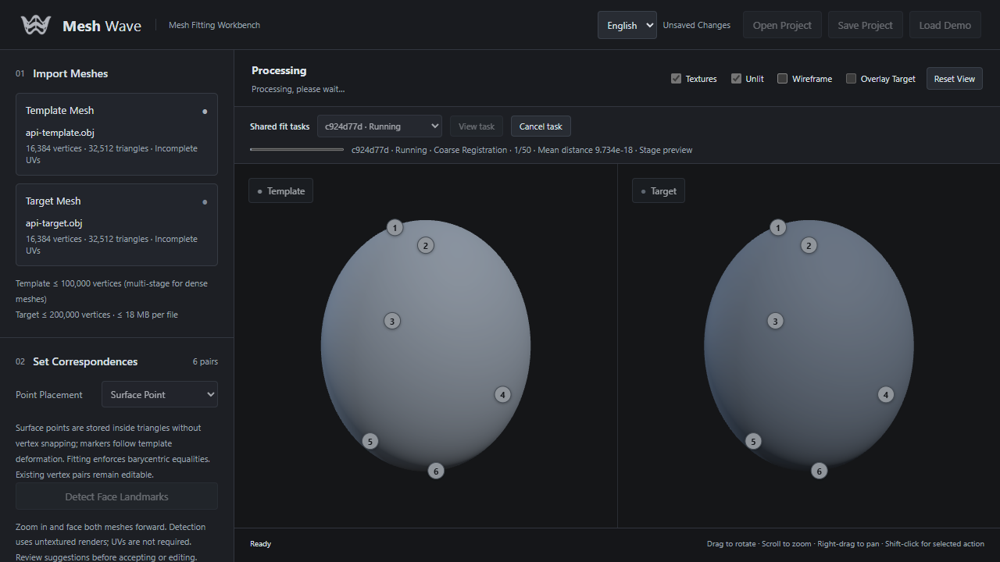

# Headless API, MCP and shared task monitoring

[简体中文](automation.md) · [README](../README.en.md)

## Start the service

Install the Python dependencies in the README, then run from the repository:

```powershell
python server.py --port 6188
```

Computing does not require an open browser. This one service supports HTTP applications, MCP and the optional viewer at http://127.0.0.1:6188/ . Do not run multiple service instances against the same output directory.

For API-only operation, disable web assets:

```powershell
python server.py --headless --port 6188
```

The viewer and viewerUrl return 404 in `--headless` mode. Use the first command if you also want browser monitoring; the solver still runs without a browser. Both API and MCP bind to loopback only. Remote authentication/public hosting are outside this release.

## HTTP API: no MCP required

`GET /api/health` returns app, apiVersion and headless.

| Method | Path | Purpose |
|---|---|---|
| POST | `/api/tasks` | Submit async fitting; HTTP 202 with task ID |
| GET | `/api/tasks` | Latest 50 shared jobs |
| GET | `/api/tasks/{id}` | Status, real solver progress, preview revision, viewerUrl |
| GET | `/api/tasks/{id}/input` | Models, settings, point/region/weight constraints |
| GET | `/api/tasks/{id}/preview` | Latest complete stage vertices, revision and stage; not final |
| GET | `/api/tasks/{id}/result` | Completed vertices and stats; other states are rejected |
| GET | `/api/tasks/{id}/export` | Completed OBJ preserving source faces and UVs |
| POST | `/api/tasks/{id}/cancel` | JSON `{}`: cancel queue entry or terminate its solver process |

Request JSON follows the existing `/api/wrap` contract:

```json
{
  "source": "v ...\nf ...\n",
  "target": "v ...\nf ...\n",
  "sourceName": "template.obj",
  "targetName": "scan.obj",
  "pairs": [[0, 0], [15, 18], [32, 40]],
  "iterations": 20,
  "smoothness": 4,
  "normalAngle": 60,
  "solverMode": "multistage",
  "excludedFaces": {"source": [], "target": [], "sourceMode": "follow"},
  "brushWeights": null
}
```

Replace placeholder geometry/indices with real anatomical correspondences. Indices are zero-based; existing continuous surface handles `{face, bary}` are also accepted (three barycentric weights). Supply 3–100 pairs; anatomy is not inferred automatically. Curve-generated sampled pairs work, but full project metadata such as editable curve controls and model textures is not synchronized through this fit request. OBJ only: 18 MB per mesh, 96 MB per request, at most 100,000 template vertices. Templates above 25,000 vertices require multistage mode.

A plain standard-library Python client is included. constraints.json contains pairs and optional existing fit settings/regions/weights:

```powershell
python examples/fit_client.py --source template.obj --target scan.obj --constraints constraints.json --output fitted.obj
```

It prints status and the viewer link, refuses to overwrite output, and requests cancellation on Ctrl+C. Existing synchronous wrapping, baking, quality and batch endpoints remain compatible and available in headless mode; those operations do not automatically appear in the new fit task monitor. Existing batches retain their own list and cancellation behavior.

## Optional MCP adapter

Start the API service first, then install:

```powershell
python -m pip install -r requirements-mcp.txt
```

For a local stdio client, let the client launch the adapter:

```json
{
  "mcpServers": {
    "mesh-wave": {
      "command": "E:\\Servers\\FaceWrapLite\\.venv\\Scripts\\python.exe",
      "args": ["E:\\Servers\\FaceWrapLite\\mcp_server.py", "--api-url", "http://127.0.0.1:6188"]
    }
  }
}
```

Replace paths with your installation. This is an example for clients using mcpServers configuration; other clients have their own configuration format. The adapter does not start the API automatically. Local Streamable HTTP is also supported:

```powershell
python mcp_server.py --transport streamable-http --port 6189 --api-url http://127.0.0.1:6188
```

Endpoint: `http://127.0.0.1:6189/mcp`. Both transports were exercised with MCP Python SDK 1.26.0.

| Tool | Purpose |
|---|---|
| service_health | Check the API service |
| submit_fit | Read request_path JSON; optionally supply both source_path and target_path to read OBJ files directly, with only constraints/settings in JSON |
| list_tasks | List shared tasks |
| get_task | Status, stage, error and preview revision |
| cancel_task | Cancel a task |
| save_preview | Save stage geometry JSON to a new output_path |
| export_result | Save completed OBJ to a new output_path, returning statistics |

Paths are on the adapter's computer. Output tools never overwrite files or create parent directories. Large meshes stay in artifacts rather than AI context. Agents must poll after submission, inspect statistics (including flip-guard early stopping), and visually inspect results before claiming success. The previous offline photo/multi-view experiments are not exposed as production MCP tools.

## Browser supervision



The Shared fit tasks bar lists tasks submitted by any entry point. Select View task, or open viewerUrl. Loading a task replaces the workspace; unsaved work triggers a confirmation first. Its models, pairs, regions and soft weights are loaded, and editing is locked while observing a running task.

Actual iteration progress and sampled error update during solving. Full mesh previews update at stage boundaries, not every vertex update; fast tasks may only show the final state. Existing solver constraints and flip protection remain in force. The observer polls about every 0.5 seconds; task list updates about every 1.2 seconds. Chinese/English can be switched at any time.

Cancel moves running → cancelling → cancelled after the worker stops, including during preprocessing or a sparse solve. The workspace discards incomplete preview geometry and restores the task's input template. The last disk preview remains inspectable but cannot be exported as a completed result. Pause/resume is not included: submit a new task after editing settings. Service restart marks unfinished tasks interrupted.

Jobs share one solver lock with existing synchronous and batch operations. At most eight async fits may be unfinished, including the running job. Input, progress, latest preview, logs and results persist in `output/tasks/{id}/`. There is no automatic retention cleanup; stop the service before archiving/deleting old job folders. The UI lists 50 recent jobs; older known IDs can still be queried.

## Verification

```powershell
python -m unittest discover -s tests -q
node --test tests/*.test.mjs
```

With optional MCP dependencies installed, a real stdio test submits fitting, saves previews, exports and cancels; without the SDK only that protocol test is skipped. Tests also cover callback numerical equivalence in both solvers, cancellation and subsequent solves, restart recovery, headless HTTP, hard correspondences and flip protection. Browser verification covers shared external-task previews/cancellation, bilingual controls and narrow layouts.
