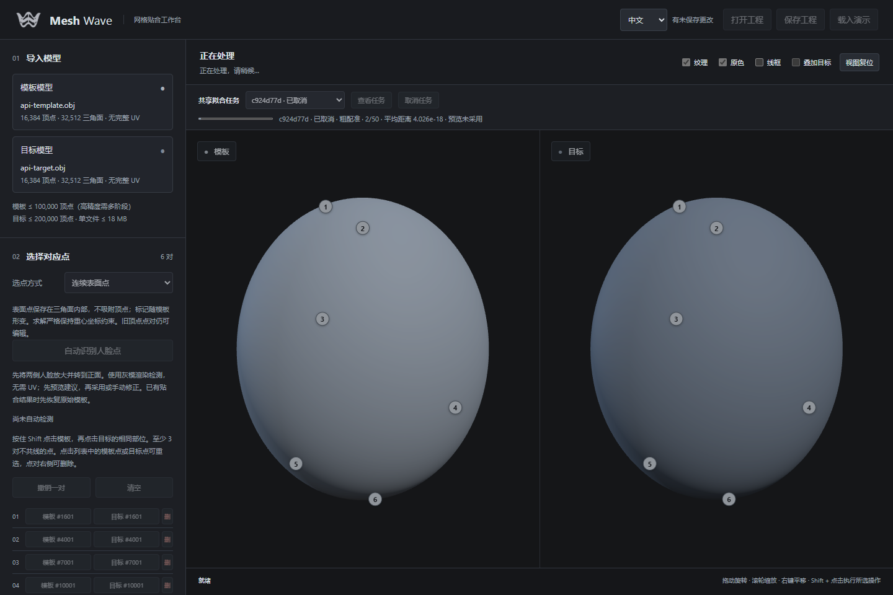

# API、MCP 与网页任务同步

[English](automation.en.md) · [返回 README](../README.md)

## 运行服务

先按 README 安装 Python 依赖，然后在仓库目录运行：

```powershell
python server.py --port 6188
```

服务不依赖浏览器，可以无人值守运行。网页只是可选的监控入口：http://127.0.0.1:6188/ 。同一服务同时供网页、普通 HTTP application 和 MCP 使用。不要针对同一 output 目录启动多个服务实例。

若只需要 API，禁用网页静态资源：

```powershell
python server.py --headless --port 6188
```

`--headless` 模式下网页及 viewerUrl 返回 404；若要边计算边打开网页监控，使用第一条命令即可，计算本身同样无需浏览器。服务与 MCP 均只监听本机，不提供远程认证或公网部署。

## HTTP API（无需 MCP）

`GET /api/health` 返回应用标识、apiVersion 和 headless 状态。

| 方法 | 路径 | 用途 |
|---|---|---|
| POST | `/api/tasks` | 提交异步拟合，返回 202 和任务 ID |
| GET | `/api/tasks` | 最近 50 项共享任务 |
| GET | `/api/tasks/{id}` | 状态、真实求解进度、最新预览版本、viewerUrl |
| GET | `/api/tasks/{id}/input` | 输入模型、参数与点对/区域/软权重 |
| GET | `/api/tasks/{id}/preview` | 最新阶段完整顶点，revision、stage；不是最终结果 |
| GET | `/api/tasks/{id}/result` | 完成结果 vertices、stats；非完成状态拒绝读取 |
| GET | `/api/tasks/{id}/export` | 完成结果 OBJ，保留模板面与 UV |
| POST | `/api/tasks/{id}/cancel` | JSON `{}`，取消排队项或终止当前任务子进程 |

提交 JSON 与原 `/api/wrap` 一致：

```json
{
  "source": "v ...\nf ...\n",
  "target": "v ...\nf ...\n",
  "sourceName": "template.obj",
  "targetName": "scan.obj",
  "pairs": [[0, 0], [15, 18], [32, 40]],
  "iterations": 20,
  "smoothness": 4,
  "normalAngle": 60,
  "solverMode": "multistage",
  "excludedFaces": {"source": [], "target": [], "sourceMode": "follow"},
  "brushWeights": null
}
```

示意点号必须换成真实解剖对应。顶点号从 0 开始；也接受现有连续表面点对象 `{face, bary}`（bary 为三个重心权重）。需要 3–100 对点；不会自动猜测身体解剖。曲线已生成的点对可以使用，任务输入不包含曲线编辑控制点或模型贴图等完整工程元数据。模型仅支持现有 OBJ 格式，每个 ≤18 MB、整个 JSON ≤96 MB，模板 ≤100,000 顶点；超过25,000模板顶点使用 multistage。

普通 Python 客户端示例（constraints.json 为含 pairs 及可选拟合设置的对象）：

```powershell
python examples/fit_client.py --source template.obj --target scan.obj --constraints constraints.json --output fitted.obj
```

客户端使用 Python 标准库，打印状态和监控链接，导出时不覆盖旧文件。Ctrl+C 会请求取消。原同步 `/api/wrap`、烘焙、质量检查、批处理等接口仍兼容，`--headless` 下也可用；它们不会自动出现在新的拟合任务栏中。原批处理继续使用既有的批处理列表和取消规则。

## MCP（可选依赖）

API 服务先运行，然后安装适配器依赖：

```powershell
python -m pip install -r requirements-mcp.txt
```

本机客户端一般采用 stdio；客户端负责启动适配器进程：

```json
{
  "mcpServers": {
    "mesh-wave": {
      "command": "E:\\Servers\\FaceWrapLite\\.venv\\Scripts\\python.exe",
      "args": ["E:\\Servers\\FaceWrapLite\\mcp_server.py", "--api-url", "http://127.0.0.1:6188"]
    }
  }
}
```

将 Python 和仓库路径替换为实际安装路径；该配置结构适用于采用 mcpServers 配置的客户端，其他客户端使用其自己的 MCP 配置方式。适配器不自动启动后台 API。也支持本机 Streamable HTTP：

```powershell
python mcp_server.py --transport streamable-http --port 6189 --api-url http://127.0.0.1:6188
```

连接地址为 `http://127.0.0.1:6189/mcp`。本轮验证 MCP Python SDK 1.26.0 的 stdio 和 Streamable HTTP。

| 工具 | 用途 |
|---|---|
| service_health | 检查 API |
| submit_fit | 读取本机 request_path 请求 JSON；可另传 source_path 和 target_path 直接读取 OBJ 文件，此时 JSON 只需约束与参数 |
| list_tasks | 查看共享任务 |
| get_task | 查看状态、阶段、误差和预览版本 |
| cancel_task | 取消任务 |
| save_preview | 将阶段网格 JSON 写到新 output_path |
| export_result | 将完成 OBJ 写到新 output_path，并返回统计 |

所有路径位于 MCP 适配器运行的电脑；两个输出工具不覆盖已有文件，不自动创建目录。大网格保存为文件，避免将数万顶点放进 AI 对话。AI 应提交任务后定期查询，不要把成功提交当作拟合完成；完成后仍需检查防翻面提前停止、误差和实际形状。MCP 接入不包含之前的照片三视图离线实验。

## 网页监督



打开网页的“共享拟合任务”栏可看到所有入口提交的任务，选择并点击“查看任务”；若当前工作区有未保存内容，会先提示保存/确认替换。也可打开返回的 viewerUrl。网页会加载任务模型与现有点对、区域、软权重，然后锁定编辑以避免混用不同任务。

运行中每次迭代更新真实进度和采样误差，每个阶段开始/结束更新完整网格预览（快速任务可能只看到最终状态）；不是逐顶点动画。预览仍受原求解器的对应点、区域和防翻面约束。进度每约0.5秒查询，列表约1.2秒更新。中英文可随时切换。

“取消任务”先显示 cancelling，确认进程终止后显示 cancelled；进程启动/预处理或单次稀疏求解中也可终止。取消后移除工作区中的未完成预览，恢复任务输入模板；保留磁盘上的最新预览供检查，但不可导出为完成结果。没有暂停/续算功能，修改参数后应提交新任务。服务重启会将未完成任务标为 interrupted。

任务与旧同步/批处理求解共享单个计算锁，最多保留8项未完成异步拟合（含运行项）。输入、进度、最新预览、日志和结果在 `output/tasks/{id}/` 持久保存；无自动清理，停止服务后可自行归档/删除旧任务目录。网页仅展示最近50项，已知 ID 仍可查询。

## 测试

```powershell
python -m unittest discover -s tests -q
node --test tests/*.test.mjs
```

安装可选 MCP 依赖后，测试会通过真实 stdio 协议调用并完成拟合、保存预览、导出和取消；未安装 SDK 时只跳过该协议测试。任务测试包含两个求解分支的数值一致性、运行中取消后继续求解、服务中断恢复、headless HTTP、硬对应点及防翻面。网页人工/自动化检查另覆盖跨入口预览与取消、中英文及窄屏布局。
